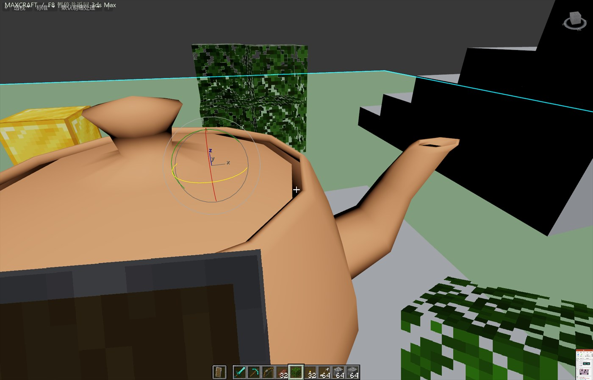

# MaxCraft — Minecraft inside 3ds Max

将真正的 Minecraft Java 通过 SkyCraft 共享内存协议接入 3ds Max。
Minecraft 负责原版物理、方块、背包和存档；Max 负责宿主场景、碰撞导出、相机和网格显示。

开发目标：Windows / 3ds Max 2027 / Minecraft 26.3 / SkyCraft Fabric 0.1.2，协议 v11。
这是宿主适配插件，不是重新实现 Minecraft 的方块小游戏。



渲染路线仿照 SkyCraft 当前源码：Minecraft 输出它生成的真实网格和贴图，Max 在自己的视口中绘制，与 Max 模型共用深度测试；手臂、背包和 HUD 由 Minecraft 直接渲染成透明画面叠加。当前 Max 宿主用临时场景网格承接，这是与 SkyCraft 的 C++ 帧内绘制的具体差异；不是两张完整游戏截图的深度合成。

## 在这台电脑上使用

1. 在 Max 的「脚本 / 运行脚本」中选择本目录的 `launch_maxcraft.py`。已安装的宏也可从 `MaxCraft > MaxCraft_Play` 打开。
2. 点「① 创建 Max 演示场景」，或准备自己的地面模型。默认 **70 Max 单位 = 1 Minecraft 方块**。
3. 点「② 建立连接并导出碰撞」，再点「启动 Minecraft 开发端」。本机依赖已准备好；首次在其他机器上运行会下载开发依赖。
4. 出现「Minecraft 已连接」后，点「③ 开始 / 继续游戏」。游戏绘制在当前 Max 原生视口上。
5. **F8 返回 Max**；「停止连接」让 Minecraft 正常保存退出，并恢复原来的 Max 视图。

| 操作 | 按键 |
|---|---|
| 行走、跳跃、疾跑、潜行 | WASD、空格、Ctrl、Shift |
| 视角 | 鼠标 |
| 挖掘 / 使用或放置 | 左键 / 右键 |
| 原版创造模式背包 | E |
| 选择快捷栏 | 1–9 / 滚轮 |
| 聊天、命令 | T |
| Minecraft 菜单 | Esc |
| 释放输入、返回 Max | F8 |

初始快捷栏第 5 格是木板。新世界使用创造模式，也保留 SkyCraft 的初始装备。
按 F8 释放输入后，后台世界仍可能继续模拟；正式退出请点击「停止连接」。
切换到其他应用会释放按键，游戏画面保留；切回 Max 即可继续，鼠标不会在其他应用中被拉回。

## 安装和依赖

- 本地安装包：`dist/MaxCraft-0.1.1.zip`。解压后在 Max 运行 `Install_MaxCraft.ms`。
- 安装器只复制到当前用户的 `scripts/MaxCraft`，并注册 `MaxCraft-Play.mcr`。游戏启动路径指向原解压目录，因此请保留该目录。
- Max 端：Max 2027.2、Python 3.13.9、PySide6 6.8.3 已实测。不需要 pip。
- Minecraft 端：JDK 25、Git、Python 3、PowerShell；使用固定 SkyCraft 源码和 Fabric Loom `runClient`。
- 本机 JDK 位于 `.runtime/jdk25`。其他机器可设置 `JAVA_HOME` 为 JDK 25，或运行 `scripts/start-dev.ps1 -JavaHome <JDK目录>`。
- 开发端使用本地开发身份 **MaxCrafter**；不会读取启动器账号或访问令牌，不提供 Realms/正版认证服务。需要账号登录的服务器应使用正常的正版启动器和同版本模组。
- 整个开发环境、Minecraft 素材和世界均位于忽略提交的 `.runtime/` 中；安装包不包含 Minecraft 本体、素材或账号文件。

## 保存、场景与卸载

Minecraft 方块、背包和游戏逻辑由真实 Minecraft 世界保存：
`.runtime/minecraft/saves/SkyCraft/`。Max 模型仍通过 `.max` 正常保存。
停止连接会移除本次会话生成的 Minecraft 显示网格；下次连接从 Minecraft 世界重新生成。
演示模型是新增的普通 Max 对象，保留在场景中。

当前每个项目对应一个 Minecraft 世界。更换完全不同的 Max 场景时，请使用单独的项目/后端世界。
编辑宿主模型后使用「刷新场景碰撞」。出生点默认在演示地面上，坐标为 Max `(35, 385, 35)`；「返回出生点」可以救回坠落玩家。

卸载前停止连接并关闭面板，再删除用户脚本目录中的 `MaxCraft` 和 `usermacros/MaxCraft-Play.mcr`。
游戏存档留在项目目录，卸载宏不会删除存档。

## 当前支持与边界

已验证真实 Minecraft ↔ Max 2027 的握手、场景碰撞、移动/跳跃、原版背包/HUD、聊天命令、放置/挖掉方块、原生 Max 网格与 UV 更新、F8 释放输入。详细数据见 [验证记录](docs/validation.md)。

- 这是 **0.1 开发版**。MC 逻辑真实运行；Max 侧使用 Python 工具插件加小型 C 原子操作 DLL，暂未做完整 Nitrous C++ 渲染插件。
- 适合小型场景/模型。碰撞导出有明确面数、采样量和区域上限；实体显示最多约 6 次/秒，复杂建筑会降低帧率。
- 原版方块可挖放；**不会把任意 Max 模型挖成洞**。不实现 Max 角色的战斗、AI、布料或物理互动。
- 支持像素纹理、面的平均着色、透明裁切和动态图集更新。树叶透明孔和篝火动画已实测；动态实体颜色/alpha 使用量化缓存，淡出有分档。多层半透明排序仍受 Max 视口限制。未接入逐顶点光照、动态方块灯或 ragdoll。
- 材质使用原版图集中的局部纹理，以最近邻放大避免 Nitrous 将像素图模糊。连接期间启用视口真实材质显示和后台渐进刷新，停止时恢复原设置。
- 游戏时请保持当前视口布局稳定。场景新建/加载前应先停止连接。
- `Local\MaxCraft_v11` 是本项目独立桥接名。不会占用 SkyCraft 原有的默认连接；同一 MaxCraft 连接仅允许一个宿主。

## 开发与验证

```powershell
scripts/build_native.cmd
python -m unittest discover -s tests -v
scripts/start-dev.ps1
python scripts/package.py
```

`scripts/integration_probe.py` 必须在 Max 的 Python 环境执行，用真实后台 Minecraft 验证移动、跳跃、背包、挖放方块和输入释放，输出 `logs/integration.json`。它不会随安装自动运行。

日志：项目 `logs/minecraft-dev.log`、`%LOCALAPPDATA%/MaxCraft/maxcraft.log`。

## 来源

沿用 [SkyCraft](https://github.com/chasmlol/SkyCraft) 的 MIT 协议和 Fabric 后端，原许可保存在 `THIRD-PARTY-SKYCRAFT-LICENSE.txt`。
参考近期 [Minecraft X Games](https://github.com/Keel62155/Minecraft-X-Games) 的宿主替换方式。调研、官方教程和固定版本见 [调研记录](docs/research.md)。
与 Mojang、Microsoft、Autodesk 或 SkyCraft 作者无官方关联。

